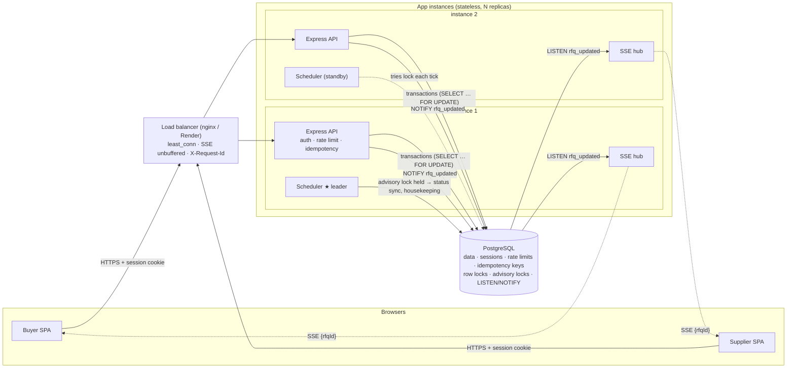
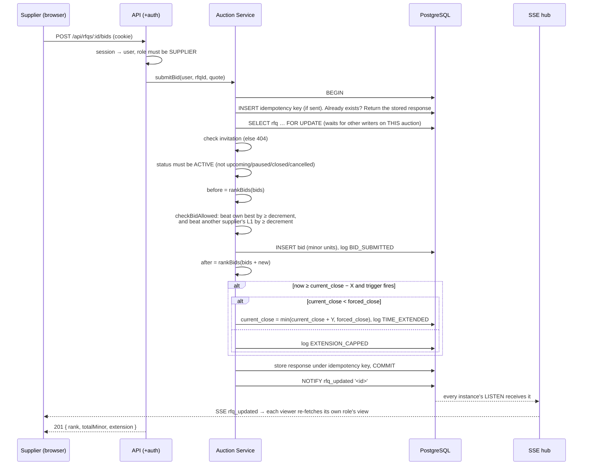
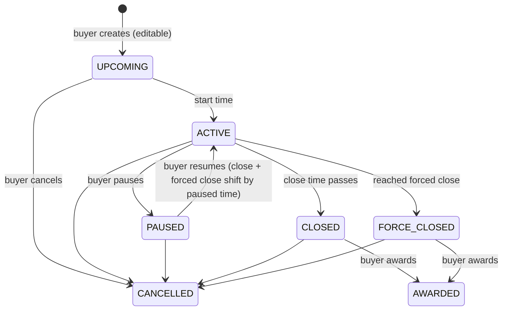

# High-Level Design — British Auction RFQ

## 1. Goal
A web app where a **buyer** creates an RFQ with British Auction rules and invites **suppliers**, who submit ever-lower quotes.
- Late activity (inside the last **X** minutes) extends the close time by **Y** minutes, never past the **forced close**.
- Suppliers compete on rank without seeing who they compete against.
- The buyer awards the RFQ after the auction closes.

## 2. Architecture

**Every instance is stateless**, so any instance can serve any request:

| State | Where it lives |
|---|---|
| Sessions | PostgreSQL `sessions` |
| Rate-limit counters | PostgreSQL `rate_limits` |
| Idempotency keys | PostgreSQL `idempotency_keys` |
| Who is watching which auction | Nowhere. Every instance broadcasts every notification to its own SSE clients, and each client re-fetches through the permission-checked API. |

### Components
| Component | Responsibility |
|---|---|
| **React SPA** | Login, role-aware listing, create/edit form, buyer view (ranking, metrics, invitations, pause/resume/cancel/award), supplier view (own rank, bid form with re-bid ceiling, a two-step confirm and an **Idempotency-Key per bid**), dashboard. |
| **Load balancer** | `least_conn` (SSE connections are long-lived), no buffering on `/api/events`, propagates `X-Request-Id`, retries a failed upstream on another instance. |
| **Express API** (`app.js`) | pino request logging with request and user IDs, session auth, role checks, JSON-only writes (CSRF), rate limits, `Idempotency-Key` passthrough, `/api/health` + `/api/ready`. |
| **Auction service** | All business rules. Every write is a transaction that **locks the RFQ row** (`FOR UPDATE`) first, so concurrent writes to one auction are serialized across instances and different auctions run in parallel. |
| **Rules / Views** | Pure ranking, trigger, extension, decrement and metrics logic. Per-role response shaping (suppliers never receive competitor data). |
| **Realtime** (`realtime.js`) | After commit, `NOTIFY rfq_updated '<id>'`. Each instance `LISTEN`s and pushes `{rfqId}` to its SSE clients. |
| **Scheduler** (`scheduler.js`) | Runs on every instance, but only the holder of a **PostgreSQL advisory lock** does the work: status transitions (UPCOMING→ACTIVE→CLOSED/FORCE_CLOSED) plus purging expired sessions, idempotency keys and rate-limit rows. If the leader dies, its connection closes, the lock is released, and another instance takes over on its next tick. |
| **Rate limiter** | Fixed-window counters with an atomic UPSERT in PostgreSQL. Throws 429 with `Retry-After`. |
| **DB layer** (`db/index.js`) | One async interface over node-postgres (production) or PGlite (embedded PostgreSQL for local dev and tests): `query`, `tx`, `listen/notify`, `tryLeadership`, `withLock`. |
| **Migrations** (`db/migrate.js`) | Ordered SQL files, checksum-verified, applied under an advisory lock. |

## 3. Bid submission flow

## 4. RFQ lifecycle

## 5. Key rules and decisions
| Topic | Decision |
|---|---|
| **Ranking** | By each supplier's best total (freight + origin + destination). Ties go to whoever reached that price first. |
| **Trigger window** | `now ≥ current_close − X`, measured from the *current* (possibly extended) close. |
| **Extension** | `new_close = min(current_close + Y, forced_close)` |
| **Triggers** | BID_RECEIVED: any bid. ANY_RANK_CHANGE: an already-ranked supplier moved (a new last-place entrant doesn't count). L1_RANK_CHANGE: the L1 supplier changed. |
| **Min decrement** | AMOUNT or PERCENT. (1) A re-bid must be ≤ own best − decrement. (2) A bid that would undercut another supplier's L1 must be ≤ L1 − decrement. Error messages never reveal the L1 price. |
| **Visibility** | Suppliers get rank, competitor count, their own bids, and optionally the L1 price. The buyer gets everything. The activity log is rewritten per supplier. |
| **Money** | Integer minor units end to end. Input is parsed from decimal strings without floating point (`toMinor`). One currency per RFQ. |
| **Pause** | Bids are rejected and the scheduler skips the RFQ. On resume both close times shift by the paused time, so suppliers don't lose bidding time. The pause is logged. |
| **Award** | Only after CLOSED/FORCE_CLOSED. Choosing a supplier other than L1 requires a reason, which keeps an audit trail. |
| **Edit** | A full edit, including rules and invites, only while UPCOMING. Invites can still be added until the auction ends. |
| **Auth** | scrypt (per-user salt). A 256-bit random session token in an `HttpOnly; SameSite=Lax` cookie, `Secure` in production. Only the SHA-256 is stored. Login uses constant-time comparison and a dummy hash, so it doesn't reveal whether an email exists. |
| **CSRF** | SameSite=Lax plus JSON-only writes. Cross-site HTML forms can't send `application/json`. |
| **Consistency** | Every write locks its RFQ row (`FOR UPDATE`). Proven by a test that fires 20 simultaneous bids against real PostgreSQL. Without the lock it loses 19 of 20 extensions and accepts duplicate bids. The scheduler uses `SKIP LOCKED`, so it never overrules an in-flight bid. |
| **Retries** | `Idempotency-Key` is stored in the same transaction as the bid, so it's exactly-once even across instances and concurrent retries. A failed request doesn't burn the key. |
| **Why Postgres for pub/sub and locks instead of Redis** | At this scale (many auctions, but writes per auction at human speed) PostgreSQL already gives transactional locks, advisory locks and LISTEN/NOTIFY. One stateful dependency means fewer moving parts. Redis becomes worthwhile when notification fan-out or rate-limit traffic gets heavy enough to load the primary database. Because realtime and rate limiting each sit behind a small interface, they can be swapped. |
| **Metrics** | Savings = lowest of each supplier's *first* quote − final L1. The dashboard compares extended and non-extended auctions, as the brief's success metric asks. |

## 6. API
| Method | Path | Role | Description |
|---|---|---|---|
| POST | `/api/auth/register` | — | Create a buyer or supplier account and sign in |
| POST | `/api/auth/login` · `/logout` | — | Session cookie |
| GET | `/api/auth/me` | — | Current user (or null) |
| GET | `/api/suppliers` | Buyer | Suppliers available to invite |
| GET | `/api/dashboard` | Buyer | Success metrics |
| GET | `/api/rfqs` | Any | Buyer: own RFQs. Supplier: invited RFQs with own rank |
| GET | `/api/rfqs/:id` | Any | Role-specific detail view |
| POST | `/api/rfqs` | Buyer | Create RFQ, rules and invitations |
| PUT | `/api/rfqs/:id` | Buyer | Edit (UPCOMING only) |
| POST | `/api/rfqs/:id/invitations` | Buyer | Invite more suppliers |
| POST | `/api/rfqs/:id/pause` · `/resume` · `/cancel` · `/award` | Buyer | Lifecycle actions |
| POST | `/api/rfqs/:id/bids` | Supplier | Submit a quote |
| GET | `/api/events` | Any | SSE stream of `rfq_updated` |
| GET | `/api/health` | — | Liveness (process up) |
| GET | `/api/ready` | — | Readiness (DB reachable, not draining). Used by the load balancer and Render. |
| GET | `/api/meta` | — | Enums |

**Errors:**
| Code | Meaning |
|---|---|
| 400 | Validation, with per-field `details` |
| 401 | Not signed in |
| 403 | Wrong role |
| 404 | Not found, or not yours / not invited |
| 409 | A business rule rejected the request |
| 415 | The request body isn't JSON |
| 422 | `Idempotency-Key` reused with a different request |
| 429 | Rate limited (`Retry-After` header) |

**Headers:** clients may send `Idempotency-Key` on `POST /rfqs` and `POST /rfqs/:id/bids`. A replayed response carries `Idempotent-Replayed: true`. Every response has `X-Request-Id` and `X-Instance`.

## 7. Deployment
| Target | Setup |
|---|---|
| **Docker Compose** (`docker-compose.yml`) | PostgreSQL 16, a one-off `migrate` job, `app` with 2 replicas (`--scale app=N`), nginx LB on :8080 (`deploy/nginx.conf`). |
| **Render** (`render.yaml`) | Managed PostgreSQL, 2 web instances, `preDeployCommand` migrations, `/api/ready` health check. |
| **Single container, no Postgres** | Embedded PGlite on a `/data` volume. Exactly one instance. |

**Graceful shutdown** (SIGTERM on deploy):
1. Readiness switches to 503, so the LB stops routing new traffic here.
2. The scheduler stops. Leadership passes to another instance within one tick.
3. SSE streams close, and browsers reconnect after the `retry: 3000` hint, landing on another instance.
4. In-flight requests finish, then the pool closes.

## 8. Rate limits
| Bucket | Limit |
|---|---|
| Login per IP | 30 / 15 min |
| Login per email | 10 / 15 min (slows password guessing on one account from many IPs) |
| Registration per IP | 10 / hour |
| Bids per supplier | 60 / min |
| Other buyer writes per user | 120 / min |

## 9. Verified behaviour
| Scenario | Result |
|---|---|
| 20 concurrent bids, one auction, real PostgreSQL, 20 connections | 20 bids, 20 extensions, close moved exactly 20 min |
| Same, with the row lock removed (control experiment) | Close moved 1 min (lost updates), duplicate bids accepted |
| 30 concurrent bids split across **two running instances** (`scripts/concurrent-bids.js`) | 30/30 accepted, 30 extensions, ranking correct |
| Bid on instance 1, browser connected to instance 2 | SSE event delivered in ~8 ms |
| Kill the leader instance | The other instance took over leadership in under 1 s |
| Two instances booting together | Migration applied once |

## 10. Next steps
- **TypeScript** across backend and frontend, with shared API types.
- Error tracking (Sentry) and metrics (Prometheus: bids/sec, lock wait time, SSE connections).
- Read replicas for the listing and dashboard queries if read traffic dominates. Partition `activity_logs` by time at high volume.
- Email verification, password reset, notifications, buyer organisations.
