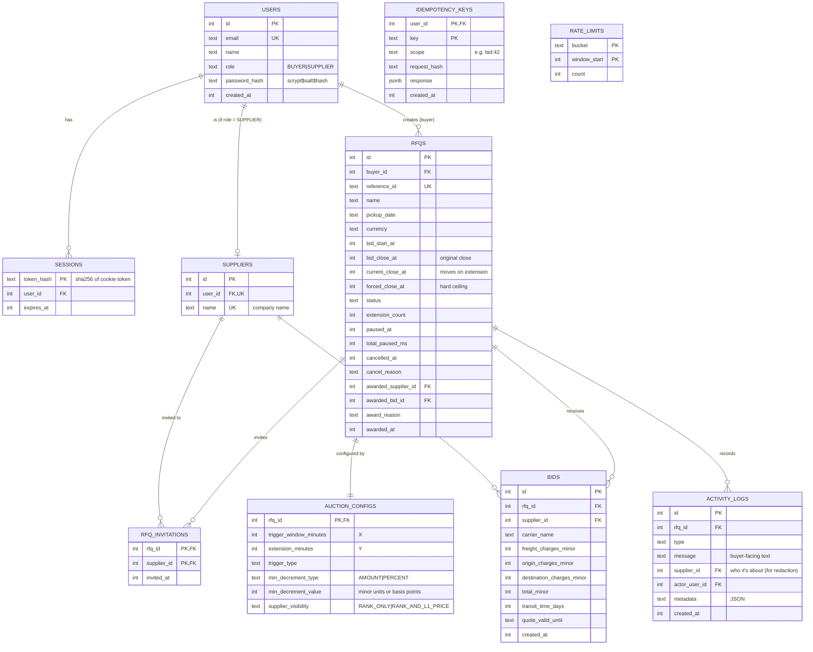

# Database Schema (PostgreSQL)

The source of truth is the migration files in [`backend/migrations/`](../backend/migrations). [`001_initial.sql`](../backend/migrations/001_initial.sql) creates everything below.
- **Timestamps:** `BIGINT` epoch milliseconds (UTC).
- **Money:** `BIGINT` minor units (cents, paise, fils).
- **Calendar dates** (pickup, quote validity): `YYYY-MM-DD` text.
- **IDs:** `BIGINT GENERATED ALWAYS AS IDENTITY`.
- **Metadata:** `JSONB`.

## Migrations
- Files are named `NNN_description.sql`. They're applied in order by [`src/db/migrate.js`](../backend/src/db/migrate.js), each in its own transaction, and recorded in `schema_migrations` (version, name, **checksum**, applied_at).
- **Never edit a migration that has been applied.** The runner refuses to start if a checksum changed. Add `002_….sql` instead.
- A PostgreSQL advisory lock around the run means two instances booting at the same moment never migrate twice. The second waits, then sees the work already done.
- Run with `npm run migrate` (deploy step, `MIGRATE_ON_START=false` on the app) or automatically at boot (the default).

## Tables

### `users`, `sessions`, `suppliers`
- `users` holds everyone who signs in. `role` decides which API actions and which view they get.
- Email uniqueness is case-insensitive via a unique index on `lower(email)`. Supplier company names work the same way, with `lower(name)`.
- `sessions` stores only a **SHA-256 hash** of the random cookie token, so a leaked database doesn't hand out working sessions. Sessions expire after 7 days, and expired rows are purged on login.
- `suppliers` is the company identity buyers invite and see in rankings. There is one row per supplier user, and the company name is unique (case-insensitive).

### `rfqs`
- `bid_close_at` keeps the original close. `current_close_at` is what extensions move.
- `paused_at` / `total_paused_ms` support pause and resume. On resume, both `current_close_at` and `forced_close_at` move forward by the paused time.
- `cancelled_*` and `awarded_*` record buyer decisions.
- `status` is persisted for filtering and history, but reads always recompute it: cancelled > awarded > paused > time-based.
- Constraints: `bid_close_at > bid_start_at`, `forced_close_at > bid_close_at`, `current_close_at <= forced_close_at`.

### `auction_configs`
The British Auction rules (X, Y, trigger type), plus:
- `min_decrement_type` / `min_decrement_value`: an AMOUNT is stored in minor units (25.00 → 2500). A PERCENT is stored in basis points (0.5% → 50).
- `supplier_visibility`: whether suppliers may see the L1 price. Names and individual quotes are never shown.

### `rfq_invitations`
Which suppliers may see and bid on an RFQ. The composite primary key prevents duplicate invites. Indexed by supplier for the supplier's auction list.

### `bids`
Append-only. Every revision is a new row. All charges are integers in minor units, and `total_minor` is their sum. A supplier's rank uses their lowest `total_minor`.

### `activity_logs`
The audit trail. `message` is the full buyer-facing text. `supplier_id` lets the API rewrite entries for a supplier: their own bids are shown, competitors' bids become "A competitor submitted a bid", and other suppliers' invitations are hidden.

| type | When | metadata |
|---|---|---|
| `RFQ_CREATED` / `RFQ_UPDATED` | buyer saves | X, Y, trigger |
| `SUPPLIER_INVITED` | invite added | — |
| `AUCTION_STARTED` | start time reached | — |
| `BID_SUBMITTED` | bid accepted | bidId, totalMinor, rank |
| `TIME_EXTENDED` | trigger fired | from, to, capped, **reason** |
| `EXTENSION_CAPPED` | trigger fired at forced close | reason |
| `AUCTION_PAUSED` / `AUCTION_RESUMED` | buyer action | pausedMs, new close times |
| `AUCTION_CLOSED` / `AUCTION_FORCE_CLOSED` | auction ended | — |
| `AUCTION_CANCELLED` | buyer cancels | — |
| `RFQ_AWARDED` | buyer awards | rank, totalMinor |

### `idempotency_keys`
One row per (user, `Idempotency-Key`). The row is inserted **in the same transaction** as the bid or RFQ it protects, and the response is stored there too:
- A retry with the same key and the same request returns the stored response.
- The same key with a different body returns 422.
- If the original request failed, its transaction rolled back the key as well, so a retry runs normally.
- Rows older than 24 h are purged by the scheduler leader.

### `rate_limits`
Fixed-window counters shared by all instances. Each check is one atomic `INSERT … ON CONFLICT DO UPDATE SET count = count + 1 RETURNING count`. Buckets look like `login-email:alice@x.com` or `bids:42`. Rows older than 2 h are purged.

### Indexes worth knowing
| Index | Serves |
|---|---|
| `rfqs (status, current_close_at)` | the scheduler's "what needs to open or close" query |
| `rfqs (buyer_id, created_at DESC)` | the buyer's listing |
| `rfq_invitations (supplier_id)` | the supplier's listing |
| `bids (rfq_id, supplier_id, created_at)`, `bids (rfq_id, total_minor)` | ranking and lowest bid |
| `activity_logs (rfq_id, created_at DESC, id DESC)` | the details page log |
| `sessions (expires_at)`, `idempotency_keys (created_at)` | housekeeping |

## Locking model
| Operation | Lock | Effect |
|---|---|---|
| Submit bid, pause, resume, cancel, award, edit, invite | `SELECT … FOR UPDATE OF r` on the RFQ row | Writes to the **same** auction are serialized across all instances, so close-time extensions can't be lost. Different auctions don't block each other. |
| Scheduler status sync | `FOR UPDATE SKIP LOCKED` | Never waits on, or overrules, an in-flight bid. A busy row is re-checked on the next tick. |
| Migrations | advisory lock `72000001` | One migrator at a time |
| Scheduler leadership | session advisory lock `72000002` | One leader in the cluster. Released automatically if the leader's connection dies. |

## Engine notes
The same SQL runs on real PostgreSQL (production, `DATABASE_URL`) and on PGlite (PostgreSQL compiled to WASM, embedded, for local dev and tests). `BIGINT` values are parsed to JavaScript numbers; every value stored (epoch ms, minor units, ids) is far below 2^53.
